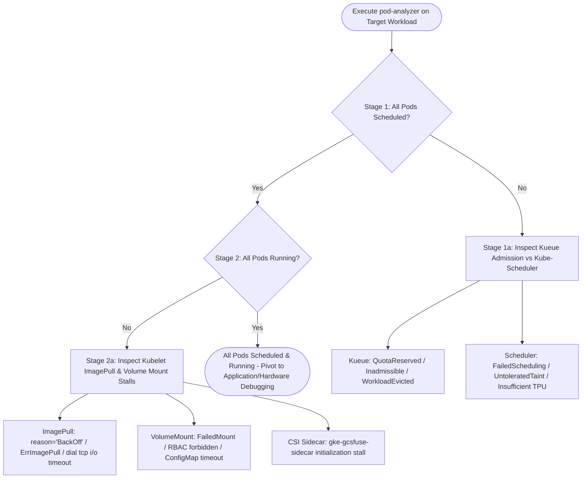

# Pod Analyzer Playbook (2-Stage Workload Verification)

## Overview

When troubleshooting multi-pod ML workloads (e.g., 2x7k / 14,336-chip JobSets),
automated agents and engineers must execute this **2-Stage Pod Lifecycle &
Scheduling SOP** before inspecting application code, framework barriers, or TPU
hardware execution halts (`TPU_EXECUTE_ERROR`). A single pod stuck in scheduling
or image pull backoff prevents collective barrier synchronization, causing
running pods to time out downstream.

The primary tool for executing this check is our dedicated Python utility via
the pod-analyzer action:

```bash
python3 tools/scripts/pull_and_format_logs.py --pod_analyzer_mode --workload_name <workload_name> --project_id <project_id> --output_file <output_path>
```

--------------------------------------------------------------------------------

## 2-Stage Decision Flowchart



--------------------------------------------------------------------------------

## Stage 1: Verify All Pods Are Scheduled

Check if all requested global replicas successfully scheduled onto nodes. If any
pods failed to schedule, `pod-analyzer` returns
`status: POD_SCHEDULING_OR_ADMISSION_FAILURE`.

### Stage 1a: Triage Admission vs Placement

1.  **Kueue Admission Blocks**: Look for `QuotaReserved`, `Inadmissible`, or
    `WorkloadEvicted`. Verify ClusterQueue quota and resource limits
    (`[[get-cluster-queues]]`).
2.  **Kube-Scheduler Placement Blocks**: Look for `FailedScheduling`
    (`Insufficient cpu/memory/tpu`), `UntoleratedTaint`, or node
    affinity/selector mismatches (`[[get-nodes-taints]]`).

--------------------------------------------------------------------------------

## Stage 2: Verify All Pods Are Running

If 100% of pods scheduled, verify that all pods transitioned cleanly from
`ContainerCreating` to `Running`. If any pods stalled or entered backoff loops,
`pod-analyzer` returns `status: POD_STARTUP_OR_INITIALIZATION_FAILURE`.

### Stage 2a: Triage Startup & Initialization Errors (Cloud Logging `--order asc` Gotchas)

1.  **Image Pull Failures (`reason: "BackOff"` vs `"ImagePullBackOff"`)**: In
    GKE and Cloud Logging, Kubelet logs container pull backoffs under
    `jsonPayload.reason: "BackOff"` or `"Failed"` with message
    `Back-off pulling image...`. During megascale bursts (14,336 chips),
    simultaneous pulls of sidecars
    (`gke.gcr.io/gcs-fuse-csi-driver-sidecar-mounter:gcsfuse_3_6_0`) or
    main containers saturate Cloud NAT and registry TCP tables
    (`dial tcp ... i/o timeout`).
2.  **Volume Mount & RBAC Failures (`FailedMount`)**: During massive pod
    assignment bursts, `NodeAuthorizer` object relationship graph propagation
    lag causes Kubelet to log `serviceaccounts "default" is forbidden... no
    relationship found between node and this object` and
    `persistentvolumeclaims ... is forbidden`.
3.  **Ascending Order Requirement**: All manual or automated verification
    queries must enforce `--order asc` from job submission so early startup
    stalls are not truncated by downstream teardown noise (`Killing` /
    `EXIT_CODE=143`).

--------------------------------------------------------------------------------

## Connections

-   **Workflows**:
    -   [[k8s-workload-verification]]
-   **Actions**:
    -   [[pod-analyzer]]
-   **Playbooks**:
    -   [[workload-disruption-orchestration]]
