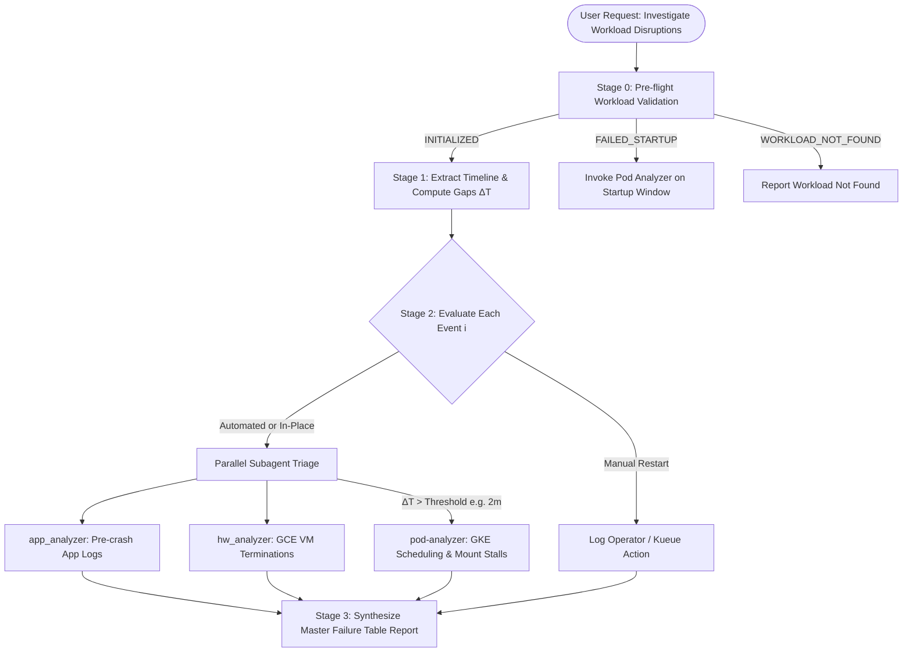

# ML Workload Disruption Orchestration & Triage Playbook

## Overview

This playbook serves as the master standard operating procedure (SOP) for the
primary orchestration agent when investigating ML workload disruptions
(restarts, reshards, and crashes).

> [!IMPORTANT] **Mandatory Subagent Execution Rule:** The main orchestrator
> agent MUST delegate work using background subagents (`dispatch_subagent`). Stage
> 1 timeline extraction MUST be executed by spawning the `job-disruption-agent`
> subagent. Stage 2 triaging MUST spawn `app_analyzer` (application logs),
> `hw_analyzer` (VM terminations), and `pod-analyzer` (GKE pod lifecycle &
> startup stalls). The main agent MUST NOT execute these stages inline.

It enforces a **clear separation of concerns**:

1.  **Scope Resolution & Independent Crash Sweep:** Establishing the complete
    node set and sweeping the full window for crash signatures *before* any
    timeline is trusted.
2.  **Disruption Timeline Extraction:** Identifying *when* restarts occurred via
    `job-disruption-agent`, then reconciling that draft against the crash sweep.
3.  **Subagent Parallel Triage:** Invoking `app_analyzer` and `hw_analyzer` to
    diagnose runtime crash reasons & VM terminations for all disruptions, and
    invoking `pod-analyzer` when startup gaps exceed a threshold ($\Delta T >
    \text{Threshold}$).
4.  **Automated Failure Table Synthesis:** Categorizing each disruption into one
    of 6 strict Case Buckets based on subagent findings.
5.  **Adversarial Verification:** Gating publication on
    [[ai-verify-failure-attribution]].

--------------------------------------------------------------------------------

## Investigation Invariants (read before every run)

These are hard rules derived from real misdiagnoses. Violating any one of them
has produced a wrong published attribution.

1.  **Never infer a culprit host from device coordinates.** A
    `DATA_LOSS: Device device(N,...,slice=K) is unplaced` message identifies
    where the *symptom surfaced*, and the slice index is frequently **not** the
    slice that died. The Pathways RM names the real host literally —
    `lost connection to peer at http://machine/<node>` and `<node> exiting`.
    Always quote it; run [[extract-culprit-hosts]].
2.  **Never assert a fleet-wide negative over a partial node set.** A single
    unsliced log query truncates at its entry cap. Run
    [[resolve-workload-nodes]] first and confirm `status: COMPLETE`; if
    `INCOMPLETE`, hardware verdicts are inconclusive, not negative.
3.  **Start every chain at the first process death, not the first reported
    error.** Client-side `DATA_LOSS` / `PlacementDataLoss` / `ValueError` /
    `JaxRuntimeError` are almost always downstream. The chain starts at a crash
    signal, a pipe break, or a host loss.
4.  **Read `si_code` on every signal.** `si_code=0` is `SI_USER`: the signal was
    sent via `kill()` by another process, **not** raised by the CPU — so
    `SIGILL si_code=0` is an external kill, not an illegal-instruction bug.
    `si_code=-6` with `from PID <self>` is a self-`abort()`, i.e. coordinated
    teardown, and must not be counted as an independent fault.
5.  **Preemption wording is not preemption evidence.**
    `EXIT_TYPE_QUICKLY_DURING_PREEMPTION`,
    `"Resource manager is being preempted"`, and
    `"Received SIGTERM ... forwarding as a preemption notification"` are emitted
    for *any* SIGTERM. Corroborate with a GCE audit event on one of this
    workload's own nodes, and check ordering: if the application process exited
    before kubelet sent SIGTERM, the wording is an artifact.
6.  **The restart timeline is a draft, not ground truth.**
    [[job-disruption-timeline]] both over-counts (duplicate `Pod Name Change` /
    `In-Place Restart` records at identical timestamps; successful termination
    logged as a restart) and under-counts (it cannot see disruptions the
    workload recovered from without restarting). Reconcile against the crash
    sweep.
7.  **Recovered disruptions are findings.** A crash the workload survived proves
    the fault is survivable, which reclassifies every failed recovery from
    "inevitable" to "recovery-path defect". Give it a table row.
8.  **Never rest a conclusion on truncated output.** Anything read through
    `head`/`tail` must be re-verified unbounded before it is published.

--------------------------------------------------------------------------------

## 3-Stage Workflow Architecture



--------------------------------------------------------------------------------

## Stage 0: Pre-flight Workload Validation

Before initiating disruption analysis, execute `validate_workload.py` to confirm
the workload initiated:

```bash
python3 tools/scripts/validate_workload.py \
    --workload <workload_name> \
    --start <start_timestamp> \
    --end <end_timestamp> \
    --project <project_id>
```

### Decision Matrix:

-   **`INITIALIZED`**: Extract `cluster_name` and `location` metadata, then
    proceed to **Stage 1**.
-   **`FAILED_STARTUP`**: Workload head pods were created in Audit Logs, but no
    `InitGoogle` initialization occurred. Invoke `pod-analyzer` on the creation
    timestamp to triage scheduling/mount errors.
-   **`WORKLOAD_NOT_FOUND`**: Stop and report `WORKLOAD_NOT_FOUND` to the user.

--------------------------------------------------------------------------------

## Stage 1: Timeline Extraction & Gap Calculation ($\Delta T$)

Execute `fetch_jobset_timeline.py` to extract the chronological array of
disruption events:

```bash
python3 tools/scripts/fetch_jobset_timeline.py \
    --workload <workload_name> \
    --start <start_timestamp> \
    --end <end_timestamp> \
    --project <project_id> \
    --output timeline.json
```

### Gap Calculation ($\Delta T$)

For each event $i$ in `timeline.json`:

1.  Calculate the time gap:
    $$\Delta T_i = \text{timestamp}_i - \text{timestamp}_{i-1}$$
2.  Compare $\Delta T_i$ against the configured startup threshold (Default: **2
    minutes / 120 seconds**).

### Timeline & Restart Analysis (High Attempt Counts)

When analyzing workloads with high restart attempt counts (e.g. 30+ attempts via
`[[job-disruption-timeline]]`), calculate inter-attempt time deltas ($\Delta
T_i$) to isolate outlier timeline gaps (e.g. $>1000\text{s}$). For each outlier
gap, explicitly cite the specific attempt number, gap duration, and individual
failure signature from that attempt's logs (e.g., slice placement `DATA_LOSS`,
GPU `cuInit` errors, or `pjit` tensor shape mismatches), alongside Kueue queue
scaling/admission delays and any manual sequence jobset transitions (e.g.
`cr1->cr2`).

--------------------------------------------------------------------------------

## Stage 2: Selective Subagent Dispatch Rules

Iterate over all events in `timeline.json` and apply the following dispatch
rules:

### Rule 2.1: Manual Recreations (`type == "Manual"`)

-   **Condition:** Suffix change in `job_name` (e.g., `cr1` $\rightarrow$
    `cr2`).
-   **Action:** Record as an operator/Kueue manual deletion and recreation.
    Categorize under **`Manual Intervention`** case bucket in the Master Failure
    Table.

### Rule 2.2: Interruption Cause Analysis & Subagent Invocation Contracts

> [!CRITICAL] **Mandatory Subagent Invocation Prompt Contracts:** To guarantee
> 100% prompt consistency across runs, the main orchestrator MUST format the
> `Prompt` argument for `dispatch_subagent` using the exact structured JSON
> contracts defined below. The main orchestrator MUST NOT use informal
> plain-text sentences or comma-separated lists of dates.

#### 1. Contract for `app_analyzer` and `hw_analyzer`:

Pass the JSON array of restart attempt objects extracted from `timeline.json`
inside a valid `json ... ` code block:

````markdown
Please analyze the following workload restart attempts for workload `{workload_name}` in project `{project_id}`:

```json
[
  {
    "attempt": 1,
    "timestamp": "2026-03-22T11:01:09.327Z",
    "previous_attempt_timestamp": "2026-03-22T11:00:00.000Z",
    "next_attempt_timestamp": "2026-03-22T11:02:22.864Z",
    "type": "Initial Launch",
    "trigger_reason": "Initial Launch",
    "job_name": "example-workload-cr4",
    "project": "[GCP_PROJECT_ID]"
  },
  {
    "attempt": 2,
    "timestamp": "2026-03-22T11:02:22.864Z",
    "previous_attempt_timestamp": "2026-03-22T11:01:09.327Z",
    "next_attempt_timestamp": "2026-03-22T11:12:03.488Z",
    "type": "Automated",
    "trigger_reason": "Pod Name Change",
    "job_name": "example-workload-cr4",
    "project": "[GCP_PROJECT_ID]"
  }
]
````

`````

#### 2. Contract for `pod-analyzer`:
Pass the filtered JSON array of startup gap attempts ($\Delta T > 120\text{s}$) extracted from `timeline.json` inside a valid ````json ... ```` code block:

```markdown
Please analyze GKE pod lifecycle & scheduling for workload `{workload_name}` in project `{project_id}` across the following startup gap attempts:

```json
[
  {
    "attempt": 6,
    "timestamp": "2026-03-22T12:04:32.932Z",
    "previous_attempt_timestamp": "2026-03-22T11:14:01.451Z",
    "delta_t_seconds": 3031,
    "job_name": "example-workload-cr6",
    "project": "[GCP_PROJECT_ID]"
  }
]
`````

Execute `python3 tools/scripts/pull_and_format_logs.py --pod_analyzer_mode
--workload_name {workload_name} --project_id {project_id}` and verify Stage 1a
(Scheduling) and Stage 2a (Startup/Mounts) status per attempt. ```

#### Subagent Execution Summary:

1.  **`app_analyzer` (Application Runtime Logs)**:
    -   Evaluates the pre-crash window
        `[previous_attempt_timestamp - 2m, timestamp]` for each attempt in the
        JSON array to detect fatal errors
        (`!!!! FATAL ERROR !!!! observed errors are` with `HARDWARE`,
        `MXLA Hang`, `TPU_EXECUTE_ERROR`, `DEADLINE_EXCEEDED`,
        `Job cancelled due to`, elastic upsharding) and output structured row
        diagnostics.
2.  **`hw_analyzer` (Hardware & VM Termination Logs)**:
    -   Scans Compute Engine system activity audit logs at
        `[timestamp - 2m, timestamp]` for host errors and terminations
        (`compute.instances.hostError`, `compute.instances.terminate`) for each
        attempt in the JSON array.
3.  **`pod-analyzer` (GKE Infrastructure & Pod Startup Logs)**:
    -   Dispatched for startup gap attempts ($\Delta T_i > \text{Threshold}$,
        e.g., $> 2\text{ minutes}$) to triage Kube-Scheduler placement failures
        (`Stage 1a`) or Kubelet container startup and CSI volume mount stalls
        (`Stage 2a`, e.g., `gke-gcsfuse-sidecar`).

--------------------------------------------------------------------------------

## Stage 3: Automated Failure Table & Pattern Analysis Synthesis

Consolidate the outputs from all subagents into the **Automated Failure Table
Schema** (see [[failure-tables]]):

When formulating the overall root cause for workloads with many restart attempts
(e.g. 50+ attempts), the summary must describe general queue scaling/admission
delays and jobset sequence changes, and cite any outlier timeline gap attempts
($>1000\text{s}$) by their actual attempt number and observed error mechanism.

### Pattern Analysis Case Buckets

Every restart attempt MUST be categorized into one of 7 strict case buckets:

1.  **`Monitor for Potential HW Issue`**: App/GKE log notes a suspicious
    machine, but no VM termination occurred.
2.  **`Recommend Node Replacement`**: $\ge 2$ distinct **primary incidents** on
    the same bad GKE instance ID. Primary vs cascade is decided by reporting
    breadth, never by raw event count -- see [[failure-tables]]. Cube-level node
    replacement is operator judgement and is not automated.
3.  **`Expected HW Interruption - No Action`**: VM termination on a machine with
    no previous failures.
4.  **`Expected HW Interruption - Detected repeated bad machine`**: Machine
    previously involved in an issue experienced a hardware termination.
5.  **`Elastic Upshard`**: Workload restarted to elastically upshard to utilize
    more slices after a checkpoint.
6.  **`Manual Intervention`**: JobSet sequence change (e.g., `cr1` $\rightarrow$
    `cr2`) or manual deletion/re-creation by operator or Kueue eviction.
7.  **`Unknown Case`**: Unable to categorize; reason for uncertainty provided in
    analysis.

### Infrastructure Specification Extraction

Prior to synthesizing the Master Failure Table, execute
[[resolve-workload-infra-specs]] to extract key hardware and machine
specifications (e.g. `machine_type: tpu7x-standard-4t`, accelerator generation,
chips per host, and topology) via `kubectl`, `gcloud compute`,
`gcloud container node-pools`, or telemetry fallbacks. These resolved
infrastructure specs must be included as an explicit primary metadata header
(`Machine Type / Infra Spec: <infra_specs>`) or dedicated column in the Master
Failure Table.

### Master Failure Table Format Schema:

```markdown
# Master Failure Table Report for `<workload_name>`
**Machine Type / Infra Spec:** `tpu7x-standard-4t` (tpu-v6e-slice, 4 chips/host)

| Jobset Name | Restart Attempt | Timestamp (UTC) | Case | Overall analysis | App log analysis of crash | GKE Logs analysis | VM Termination analysis |
| :--- | :--- | :--- | :--- | :--- | :--- | :--- | :--- |
| `example-workload-2x7k` | 1 | `2026-03-21T02:02:31Z` | Elastic Upshard | Normal initial launch & elastic upshard event | Identified elastic upshard event | GKE workload scheduled successfully | No VM Termination |
| `example-workload-2x7k` | 3 | `2026-03-21T07:42:06Z` | Monitor for Potential HW Issue | GKE instance stuck in volume mount stall | [Logs](https://console.cloud.google.com/logs/query;query=resource.labels.pod_name:%22example-workload-2x7k-%22;project=[GCP_PROJECT_ID]) No Logs - workload didn't init | GKE Pods instance stuck in volume mount (`gke-gcsfuse-sidecar`) | No VM Termination |
```

--------------------------------------------------------------------------------

## Execution Checklist for Main Agent

-   [ ] Run `validate_workload.py` (Stage 0 pre-flight check).
-   [ ] **Dispatch `job-disruption-agent` subagent** to extract the disruption
    timeline (`timeline.json`) via `fetch_jobset_timeline.py` (Stage 1).
-   [ ] Compute time gaps $\Delta T$ between consecutive events from
    `timeline.json`.
-   [ ] **Dispatch triage subagents (`app_analyzer`, `hw_analyzer`,
    `pod-analyzer`) with per-attempt JSON payloads** from `timeline.json` (Stage
    2). Batch multiple restart event payloads into `dispatch_subagent` calls for
    parallel evaluation.
-   [ ] Categorize each event into one of the 7 Failure Table Case buckets
    (Stage 3).
-   [ ] **Run [[resolve-workload-infra-specs]]** to resolve hardware machine
    type, accelerator type, and topology (Stage 3).
-   [ ] Synthesize and present the Master Failure Table Report with Machine Type
    / Infra Spec (Stage 3).

--------------------------------------------------------------------------------

## Connections

-   **Actions**:
    -   [[job-disruption-timeline]]
    -   [[resolve-workload-infra-specs]]
-   **Playbooks**:
    -   [[pod-analyzer-playbook]]
-   **Symptoms**:
    -   [[elastic-reshard-pytree-mismatch]]
    -   [[false-preemption-sigterm]]
    -   [[incomplete-checkpoint-restore]]
    -   [[sigill-worker-kill]]
-   **Concepts**:
    -   [[failure-tables]]
    -   [[job-disruption-detection]]
